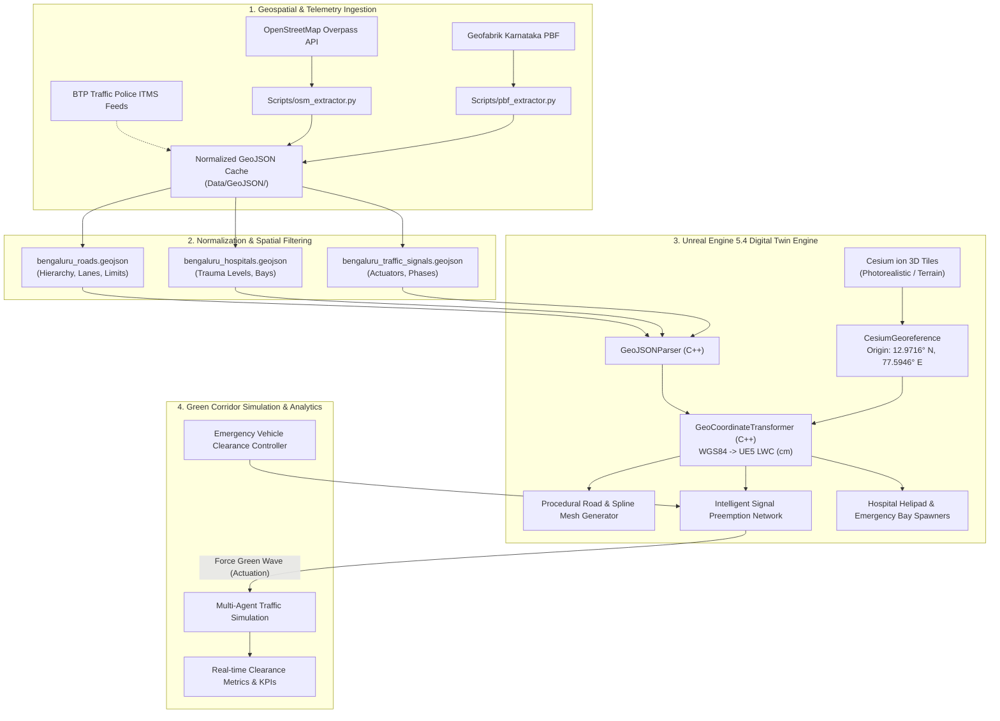

# Bengaluru Smart Mobility & Emergency Vehicle Green Corridor Digital Twin

> **High-Fidelity Unreal Engine 5.4 Simulation & Intelligent Traffic Clearance System for Central Bengaluru**

[](https://www.unrealengine.com/)
[](https://cesium.com/platform/cesium-for-unreal/)
[](https://www.python.org/)
[](LICENSE)

---

## 1. Executive Summary

Bengaluru, the Silicon Valley of India, faces acute urban mobility bottlenecks with an average peak vehicular speed below 15 km/h in central corridors. For critical medical transport—such as organ transit, acute stroke intervention, and polytrauma evacuation—unpredictable congestion can lead to catastrophic delays.

The **Bengaluru Digital Twin Traffic Clearance System** is a next-generation cyber-physical simulation platform built upon **Unreal Engine 5.4** and **Cesium for Unreal**. By integrating OpenStreetMap (OSM) spatial topologies, photorealistic 3D geospatial tiles, Large World Coordinates (LWC), and dynamic traffic signal preemption protocols (ITMS), this system models, tests, and validates automated **Green Corridors** across central Bengaluru's critical medical transit axis.

```
       [ Majestic Terminal ]
                 |
                 v
        [ K.R. Circle ] <--------> [ Vidhana Soudha ]
                 |                         |
                 v                         v
       [ St. Martha's Hospital ]     [ Bowring Hospital ]
                 |                         |
                 v                         v
     [ Corporation / Town Hall ]      [ M.G. Road Corridor ]
                 |
                 v
        [ K.R. Market ]
                 |
                 v
     [ Victoria Hospital (BMCRI) ]
```

---

## 2. System Architecture

The digital twin combines high-throughput data extraction, geodetic-to-Cartesian coordinate transformations, procedural spline road generation, and multi-agent emergency vehicle routing.



---

## 3. Key Technical Innovations

### Large World Coordinates (LWC) Double Precision
By leveraging Unreal Engine 5's 64-bit coordinate space combined with `CesiumGeoreference`, the system anchors simulation assets anywhere within Greater Bengaluru with sub-millimeter precision, eliminating floating-point jitter across 50+ kilometer corridors.

### Procedural Road Spline Ingestion
Road geometry extracted from OSM LineStrings is ingested into `GeoJSONParser` and extruded into multi-lane road cross-sections with asphalt shaders, lane markings, sidewalk borders, and elevation adjustments calibrated to central Bengaluru's ~920m datum.

### Intelligent Traffic Signal Preemption (ITMS V2)
The 15 primary junctions in the corridor—including Sir M. Visvesvaraya (K.R.) Circle, Hudson Circle, and Corporation Circle—are modeled as stateful signal controllers. Approaching emergency vehicles trigger proactive signal preemption:
- **Phase Hold**: Side streets and opposing flows receive immediate amber-to-red transitions.
- **Flushing Phase**: Ahead-of-vehicle queues are released with green waves before arrival.
- **Corridor Recovery**: Post-passage graceful restoration of adaptive traffic timing.

---

## 4. Repository Structure

```
traffic-clearance-system/
│
├── Config/                               # UE5 Configuration Profiles
│   ├── DefaultEngine.ini                 # Nanite, TSR, Lumen, LWC, Cesium settings
│   └── DefaultGame.ini                   # Project metadata & simulation parameters
│
├── Data/
│   └── GeoJSON/                          # Normalized Central Bengaluru Spatial Datasets
│       ├── bengaluru_roads.geojson       # 19 arterial & secondary road segments
│       ├── bengaluru_hospitals.geojson   # 5 emergency hospital POIs with capacities
│       └── bengaluru_traffic_signals.geojson # 15 smart signal nodes & actuators
│
├── Scripts/                              # Data Extraction & Testing Pipeline
│   ├── osm_extractor.py                  # Live Overpass API extraction with retries
│   ├── pbf_extractor.py                  # High-speed local Osmium PBF file parser
│   ├── test_extractors.py                # Unit & regression test suite
│   └── requirements.txt                  # Python dependencies
│
├── Source/
│   └── TrafficClearance/                 # High-Performance C++ Simulation Module
│       ├── GeoCoordinateTransformer.h    # WGS84 to UE5 local Cartesian math
│       ├── GeoCoordinateTransformer.cpp  # Batch transformation routines
│       ├── GeoJSONParser.h               # High-speed JSON schema parser
│       ├── TrafficClearance.Build.cs     # Module dependencies (Cesium, Json, ProcMesh)
│       ├── TrafficClearance.h            # Module definition header
│       └── TrafficClearance.cpp          # Module startup implementation
│
├── TrafficClearance.uproject             # Unreal Engine 5.4 project descriptor
├── README.md                             # System overview and architecture
└── SETUP_GUIDE.md                        # Step-by-step installation and run guide
```

---

## 5. Central Bengaluru Reference Corridor

The bundled sample dataset covers the critical **Majestic – Victoria Hospital – KR Market – MG Road** corridor:

| Landmark / Node | Type | Coordinates (WGS84) | Elevation | Critical Functions |
|---|---|---|---|---|
| **Majestic (KSR / BMTC)** | Transport Hub | 12.9778° N, 77.5729° E | 922.0 m | Primary inter-city railway & bus transit hub |
| **K.R. Circle (Sir MV)** | 5-way Junction | 12.9752° N, 77.5871° E | 922.5 m | High-density arterial convergence |
| **St. Martha's Hospital** | Emergency Hub | 12.9702° N, 77.5873° E | 921.8 m | Level 2 trauma, 550 beds, acute cardiology |
| **Hudson Circle** | Roundabout | 12.9680° N, 77.5875° E | 920.9 m | Police Corner / Cubbon Park arterial gate |
| **Town Hall / Corporation Circle** | 4-way Junction | 12.9667° N, 77.5872° E | 920.1 m | BBMP headquarters, N.R. Road entrance |
| **K.R. Market Flyover** | Multi-level Node | 12.9658° N, 77.5765° E | 916.5 m | High pedestrian density & commercial transit |
| **Victoria Hospital (BMCRI)** | Level 1 Trauma | 12.9628° N, 77.5746° E | 915.0 m | 1,050 beds, burn unit, helipad, Level 1 trauma |
| **Vidhana Soudha** | Civic Zone | 12.9796° N, 77.5907° E | 924.0 m | Government Secretariat & Dr. Ambedkar Veedhi |
| **Bowring & Lady Curzon Hospital** | Level 1 Trauma | 12.9829° N, 77.6027° E | 923.0 m | 686 beds, 64 ICU bays, Shivajinagar hub |
| **Anil Kumble Circle (MG Road)** | Commercial Node | 12.9748° N, 77.6045° E | 922.2 m | Central Business District arterial spine |

---

## 6. Quick Verification

You can immediately verify the bundled sample datasets with Python:

```bash
# Verify GeoJSON integrity and feature counts
python -c "import json, glob; [print(f, len(json.load(open(f))['features'])) for f in glob.glob('Data/GeoJSON/*.geojson')]"
```

Output:
```text
Data/GeoJSON/bengaluru_hospitals.geojson 5
Data/GeoJSON/bengaluru_roads.geojson 19
Data/GeoJSON/bengaluru_traffic_signals.geojson 15
```

For complete project setup, Cesium ion token configuration, and running the simulation in Unreal Engine 5.4, follow the [SETUP_GUIDE.md](file:///c:/Users/tamil/Downloads/traffic-clearance-system/SETUP_GUIDE.md).

---

## 7. License & Research Attribution

Developed for smart urban mobility research and emergency logistics planning in Bengaluru, Karnataka, India.  
Copyright &copy; 2026 Bengaluru Digital Twin Initiative. All Rights Reserved.
